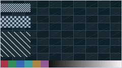

# LCD background test chart

Use this chart as a reference for Pet Companion backgrounds on the Cardputer ADV. The fine patterns and diagonal lines on the left help reveal scaling and row-alignment errors. The bottom strip shows color swatches and a grayscale ramp. The darker center leaves room for the model.

- Canvas size is **240 × 135 pixels**. The PNG is opaque and already uses colors representable in RGB565.
- Export pixels in top-to-bottom row order, left-to-right within each row. A full-screen RGB565 image takes **64,800 bytes**. For 8-bit RGB channels, the 16-bit pixel value is `((r & 0xf8) << 8) | ((g & 0xfc) << 3) | (b >> 3)`.
- To check tearing, animate a straight vertical stripe across the high-contrast strip. A horizontal break in the stripe is the cue to look for. Pet Companion draws the stripe over this image at runtime.

No tearing was visible during the Cardputer ADV check. With the static chart in place during Wi-Fi reconnection and HTTPS, the measured average was 20.83 fps and the longest frame interval was 57.08 ms.
